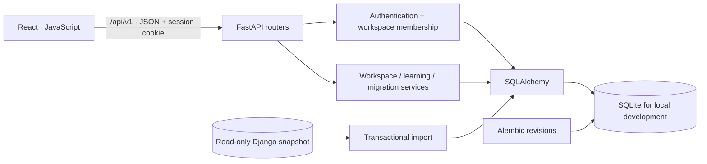

# Архитектура Re:Search

## Подход

Модульный монолит с отдельным React-клиентом. Для небольшой команды это даёт
явные границы ответственности без необходимости обслуживать несколько сервисов.
Одна транзакционная БД хранит рабочие пространства, проекты и знания; API не зависит
от Django. Старая версия существует только как архив и источник переноса.

Для PostgreSQL предусмотрен `postgresql+psycopg://` URL. Переход требует применения
миграций, отдельного переноса данных и интеграционного прогона на PostgreSQL; сама
смена переменной не переносит SQLite-данные.

## Границы модулей

| Модуль | Ответственность |
| --- | --- |
| `api/auth.py` | Регистрация, вход, выход, профиль, демо-сессия |
| `api/dependencies.py` | Аутентификация, членство, права записи и владения |
| `api/projects.py` | Проекты, задачи, назначение исполнителя и прогресс |
| `api/knowledge.py` | Библиотека, закладки, обсуждения, комментарии и поддержка |
| `api/workspaces.py` | Пространства, участники, приглашения, поиск, показатели и активность |
| `api/catalog.py` | Открытый каталог, прогресс чтения, сохранение и запуск учебного проекта |
| `services/catalog.py` | Проверяемая в Git редакционная стартовая подборка |
| `services/demo.py` | Отдельные демонстрационные пользователи и пространства |
| `services/legacy.py` | Транзакционный импорт исторического снимка |

Миграции содержат конкретные операции над схемой; приложение не запускает
`create_all()` в production. Миграции выполняются отдельно перед запуском.
В тестах применяется та же Alembic-цепочка, что и при установке.

## Модель данных

- `User` → серверные `LoginSession`, персональный `ReadingProgress`.
- `User` ↔ `Workspace` через `Membership`: `owner`, `member`, `viewer`.
- `Workspace` → `Project`, `Task`, `Resource`, `Discussion`, `Activity`, `Invitation`.
- `Project` → задачи; материалы и обсуждения могут быть связаны с проектом.
- `Discussion` → `Comment`; составной ключ `Vote(user_id, discussion_id)` исключает
  повторную поддержку одного обсуждения одним человеком.
- `Bookmark(user_id, resource_id)` принадлежит конкретному пользователю.
- `PlanInterest` хранит интерес к гипотезе тарифа, не платёж и не подписку.
- `LegacyMapping` обеспечивает повторяемость импорта одного снимка.

Проект и его материалы доступны участникам пространства, а не всему интернету.
Процент прогресса вычисляется из задач; счётчики и активность берутся из базы.
Уровень интереса пользователя не является security role.

## Доступ и сессии

Пароли новых аккаунтов: scrypt, отдельная случайная соль. Импортированные
`pbkdf2_sha256` проверяются совместимо с Django и обновляются при входе.

Сессия — случайный 256-битный токен в `HttpOnly`, `SameSite=Lax` cookie; в базе
хранится SHA-256 токена и срок действия. Выход удаляет серверную сессию.
В production cookie обязательно `Secure`, демо выключено.

Изменяющие запросы требуют нестандартный заголовок `X-Requested-With: ReSearch`.
Обычная внешняя HTML-форма не может его поставить; запрос скрипта с другого
источника проходит строгий CORS allowlist. Если `Origin` присутствует, он также
проверяется непосредственно middleware.

Каждый scoped endpoint сначала проверяет membership, затем принадлежность
конкретной записи пространству. ID чужого проекта нельзя использовать для
создания своей задачи. Наблюдатель может читать и вести личное избранное,
но не изменять командные данные. Владелец приглашает участников и редактирует
пространство; автор или владелец редактирует проект/материал.

Приглашение — одноразовый случайный токен с SHA-256 в БД, сроком 7 дней и
привязкой к email аккаунта. Ссылку передаёт владелец; почтовой отправки и
отдельного подтверждения email пока нет.

## Клиент

React Router отвечает за страницы, Context — за сессию и текущий workspace.
Компоненты страниц вызывают единый `api()`-клиент. Рабочие данные загружаются
пакетом, после успешной мутации обновляются с сервера. Переход между пространствами
отменяет предыдущие запросы и не показывает данные предыдущего workspace.

Локально сохраняется только ID выбранного пространства, не токен авторизации.
Состояния загрузки, ошибки, пустые списки, доступ только для чтения и повторная
попытка представлены в UI. Формы используют явные label, диалоги — нативный
`dialog` с фокусом и Escape. Пользовательский текст рендерится как текст, не HTML.
Интерфейс использует системные шрифты и не требует внешнего font CDN.

## Ограничения пилота

Списки ограничены размером ответа (обычно 100, задачи 200); для большого количества
данных следующий этап — серверная пагинация и query cache. Поиск кириллицы в
SQLite использует casefold по записям текущего пространства; при росте нужен
PostgreSQL FTS/trigram и индексы. Сериализация карточек пока делает дополнительные
запросы для связанных счётчиков; оптимизацию стоит подтвердить профилированием.

Сейчас нет фоновой очереди, WebSocket, полнотекстового поиска по файлам, uploads,
сообщений по email и платёжного провайдера. Они не маскируются фиктивными кнопками.
Стартовый каталог — кодовый редакционный набор; полноценная редакция потребует
CMS, модерации и истории исправлений.

## Паспорт исследования

Миграция `c91d1027b8ab` добавляет в Project четыре Text-поля с пустым server default:
question, method, limitations, conclusion. Старые проекты и архивный импорт
сохраняют данные; пустой паспорт отображается явно. Отдельный
`PATCH /workspaces/{workspace_id}/projects/{project_id}/protocol` валидирует длины,
права автора/владельца и tenant boundary, затем записывает Activity в транзакции.
Обычный PUT метаданных проекта эти поля не изменяет. Экспорт Markdown выполняется
на клиенте из серверного паспорта и реально связанных источников.

Это актуальная версия документа, без версионной истории, разрешения конфликтов
и peer review. Одновременное редактирование использует last-write-wins; перед
пилотом с параллельной работой над одним паспортом нужны revision/ETag и история.

UI разделён на оболочку, журнал, реестр, паспорт, библиотеку/инспектор, обсуждения
и читательский каталог. `EvidenceMap` — доступная таблица существующих записей,
без сервиса научного скоринга. Визуальные токены и motion выделены из CSS.
`@axe-core/playwright` используется только в тестах, в runtime bundle не входит.
